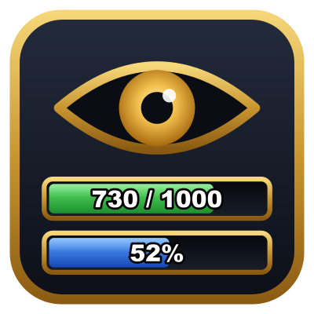

<p align="center"></p>

# AlwaysOnDisplay

A World of Warcraft **Forever** addon that always shows the numbers for your health and resource (mana, energy, rage) on the default player and target frames. You don't have to hover over a bar to see them.

```
 ┌──────────────────────────────┐
 │  1234 / 2000                 │  ← health
 │  500 / 1000                  │  ← mana / energy / rage
 └──────────────────────────────┘
```

## Features

- Always-visible text on four bars: **player health**, **player resource**, **target health** and **target resource**. Each one can be turned on or off separately.
- Works for every resource type, and switches automatically when a druid changes form.
- Energy and rage update with every tick.
- Four text formats: `1234 / 2000` (default), `1234` (current only), `1234 / 2000 (62%)`, or `62%`.
- Your absorb **shield** is shown next to the current health in any format, for example `1234 +300 / 2000` or `62% +300`. It disappears when the shield breaks, and you can turn it off.
- Optional short numbers: `12.3k`, `1.5m`.
- Enemy targets show `45%`. Forever's Classic-style servers only give a percentage for enemy health, not real numbers. Party and raid members, and you, show full values.
- Dead and ghost units show `Dead` or `Ghost`. The resource text is hidden for targets with no resource.
- While the addon's text is on for a bar, it hides the game's own hover text on that bar so the two never overlap.
- A minimap button opens the settings. Drag it to move it around the minimap, or hide it. There's also an entry in the minimap's **AddOns** menu.

## Installation

1. Download the latest `AlwaysOnDisplay-vX.Y.Z.zip` from the [Releases page](https://github.com/4perbio/AlwaysOnDisplay/releases/latest), then unzip it so that the `AlwaysOnDisplay` folder lands in
   `C:\Program Files (x86)\World of Warcraft\_forever_\Interface\AddOns\`
   (or copy the `AlwaysOnDisplay` folder from this repository there).
2. Restart the game, or type `/reload`, and make sure **AlwaysOnDisplay** is enabled in the AddOns list on the character screen.

<details><summary>Manual install from source</summary>

1. Copy the `AlwaysOnDisplay` folder (the one containing `AlwaysOnDisplay.toc`) into
   `C:\Program Files (x86)\World of Warcraft\_forever_\Interface\AddOns\`
2. Restart the game, or type `/reload`, and make sure **AlwaysOnDisplay** is enabled in the AddOns list on the character screen.

</details>

For development, link the folder instead of copying it, so a `/reload` picks up your changes:

```powershell
New-Item -ItemType Junction `
  -Path   "C:\Program Files (x86)\World of Warcraft\_forever_\Interface\AddOns\AlwaysOnDisplay" `
  -Target "C:\Users\absolute\projects\AlwaysOnDisplay\AlwaysOnDisplay"
```

## Usage

Everything is on by default. To change it:

- click the **AlwaysOnDisplay minimap button** (or its entry in the minimap's AddOns menu),
- open **Options → AddOns → AlwaysOnDisplay**, or
- type `/aod` to open that panel directly.

Drag the minimap button to move it along the minimap edge. Its position is saved. Hovering over it shows the installed version, for example `v1.0.6`.

| Option          | Default             | What it does                                              |
|-----------------|---------------------|-----------------------------------------------------------|
| Player health   | on                  | Health text on your own frame                             |
| Player resource | on                  | Mana / energy / rage text on your own frame               |
| Target health   | on                  | Health text on the target frame                           |
| Target resource | on                  | Mana / energy / rage text on the target frame             |
| Text format     | `1234 / 2000`       | Value and max, current only, value and percent, or percent only |
| Short numbers   | on                  | Shortens numbers from 10,000 up (`12.3k`, `1.5m`)         |
| Show shield amount | on               | Absorb shield next to current health (`1234 +300 / 2000`) |
| Show minimap button | on              | The settings button on the minimap edge                   |

Changes apply immediately and are saved account-wide in `WTF\Account\<account>\SavedVariables\AlwaysOnDisplay.lua`.

### Slash commands

| Command      | Effect                          |
|--------------|---------------------------------|
| `/aod`       | Open the options panel          |
| `/aod minimap` | Show or hide the minimap button |
| `/aod debug` | Print what the client supports and what each bar is doing (useful for bug reports) |
| `/aod reset` | Restore all options to defaults, including the minimap button's position |

## Troubleshooting

**"AlwaysOnDisplay: could not find some unit frame bars" in chat.**
The addon looks for the default bars under several known names:
`PlayerFrameHealthBar` / `PlayerFrameManaBar` / `TargetFrameHealthBar` / `TargetFrameManaBar`, the modern nested `PlayerFrame.PlayerFrameContent…` paths, and `PlayerFrame.healthbar` / `.manabar`. If a game update renames them, or another unit frame addon replaces them, they won't be found. Hover the bar, type `/fstack` to see its frame name, and add it to `BAR_CANDIDATES` in `AlwaysOnDisplay/Core.lua`.

**"could not show … text, using the game's own text instead" in chat.**
Something went wrong while drawing the text on that bar, so the addon gave the bar back to the game's own text instead of leaving it blank. Type `/aod debug` and include its output when you report the problem.

**Text shows only `1234 / 2000` without a percent, or only a bare number.**
WoW Forever protects health and power as *secret values* (see "How it works"). If the client offers no way to turn them into a percent or formatted text, the addon shows what it is allowed to. `/aod debug` shows which of these the client supports.

**Text shows twice.**
Another addon, or the game's *Status Text* interface option, is drawing text on the bar too. Turn off one of them.

**Target health shows only a percent.**
This is expected for enemies. The server only tells the game the percentage.

## How it works

The addon draws **its own text** on top of each Blizzard bar rather than switching the game's hover text on. That makes it independent of the game's *Status Text* setting, and it never calls protected Blizzard code, so it can't cause taint or "action blocked" errors in combat.

```
AlwaysOnDisplay/
├── AlwaysOnDisplay.toc   addon info (Interface 16001, SavedVariables, icon, AddOns-menu entry)
├── Icon.tga              64×64 icon (AddOns list, minimap button)
├── Core.lua              finding the bars, formatting, event handling
├── Options.lua           settings panel and /aod
└── Minimap.lua           minimap button and AddOns-menu entry
```

- **`Core.lua`**
  - `BAR_CANDIDATES` holds the list of places to look for each bar.
  - `Setup` creates an overlay frame 5 levels above each bar, holding one centered `TextStatusBarText` font string.
  - `UpdateDisplay` reads `UnitHealth` and `UnitPower(unit, UnitPowerType(unit))`, then formats the result.
  - **Secret values.** WoW Forever runs on the modern engine, where `UnitHealth`, `UnitPower` and sometimes their max return *secret* numbers. Addon code may not do math, comparisons or `and`/`or`/`==` tests on them, but it may pass them to `FontString:SetText`. The rules differ from Retail, and Retail's documentation contradicts itself, so the code never assumes:
    - Readable values are formatted normally.
    - For secret values, the text is built only with calls run inside `pcall`: `string.format("%s / %s")`, `AbbreviateLargeNumbers`, and `UnitHealthPercent` / `UnitPowerPercent` with `CurveConstants.ScaleTo100`. Each one falls back if the client refuses it, ending with the bare current value.
    - Checks for missing values use `type()`. A secret max power counts as "has this resource".
    - Every bar update runs inside `pcall`. If it fails, our text is hidden and Blizzard's text is restored, so a bar is never left blank. The error is kept for `/aod debug`.
  - The events listened to are `PLAYER_LOGIN`, `PLAYER_ENTERING_WORLD`, `PLAYER_TARGET_CHANGED`, plus `UNIT_HEALTH`, `UNIT_MAXHEALTH`, `UNIT_POWER_UPDATE`, `UNIT_POWER_FREQUENT`, `UNIT_MAXPOWER`, `UNIT_DISPLAYPOWER` and `UNIT_FLAGS`. The unit events only fire for `player` and `target`.
- **`Options.lua`**: builds the panel with the modern `Settings` API (`RegisterVerticalLayoutCategory`, `RegisterAddOnSetting`, `CreateCheckbox`, `CreateDropdown`). Each setting is bound directly to `AlwaysOnDisplayDB`, and every change calls `ns.Refresh()`.
- **`Minimap.lua`**: a self-contained button with no library dependencies. It is named `AlwaysOnDisplayMinimapButton`, so minimap-button collectors can find it. Its position is stored as an angle in `AlwaysOnDisplayDB.minimapAngle`. While you drag it, it follows the cursor using the minimap's effective scale. `AlwaysOnDisplay_OnAddonCompartmentClick` is the click handler for the AddOns-menu entry.

## Development & tests

The tests run outside the game, against a mocked WoW API (`tests/wow_mock.lua`). They are executed by [fengari](https://github.com/fengari-lua/fengari), a Lua VM in JavaScript, so you only need **Node.js**. No Lua install is required.

```powershell
npm install   # once
npm test
```

The tests cover:

- **Saved variables**: defaults are filled in and existing values are kept.
- **Finding the bars**: all three frame layouts work, a missing bar gives a single warning, and the overlay is created once.
- **Formatting**: every format and short-number case, and rounding.
- **Target**: no target, enemy percent versus party values, no resource, dead/ghost.
- **Live updates**: energy ticks, shapeshifts, and filtering events by unit.
- **Options**: settings registration and types, the dropdown choices, live changes from the panel, and `/aod` / `/aod reset`.
- **Secret values**: the mock's secret numbers raise on math, comparisons and concatenation, like the client. The tests run every scenario the docs disagree on: percent API missing, plain or secret; `string.format` accepting or refusing secrets; with and without `AbbreviateLargeNumbers`. They also cover secret target values, the fallback to Blizzard's text, and `/aod debug`.
- **Current-only format and shield** (`tests/test_shield.lua`): the shield in every format, short numbers, targets, the opt-out, clients without `UnitGetTotalAbsorbs`, and secret shields with and without the `C_StringUtil` zero-aware helpers.

**About secret shields:** while the shield amount is readable, a shield of 0 is simply hidden. When it's a secret, the addon isn't allowed to compare it with 0. It then uses the client's `C_StringUtil.TruncateWhenZero` and `WrapString` helpers, which can turn a secret 0 into an empty string. If the client doesn't have them, the shield is left out instead of showing a constant `+0`. `/aod debug` shows whether the client has these helpers.
- **Minimap button**: creation, default and saved positions, click, tooltip, dragging (including minimap scale), hiding and showing, `/aod minimap`, and the AddOns-menu entry.

The mock loads the Lua files in the order the `.toc` lists them, the same way the game does.

To add a test, write a `test("name", function() ... end)` block in `tests/test_core.lua`, `tests/test_options.lua` or `tests/test_minimap.lua`. `mock.new{layout=…, savedDB=…}` builds a fresh client, `mock.login(env)` loads the addon, `mock.fire(env, event, ...)` sends events, and `mock.visibleText(env, "playerHealth")` reads what's on a bar. A new test file must also be added to `SUITES` in `tests/run.lua`.

## Releases

Every push to `main` triggers `.github/workflows/release.yml`. It runs the tests, and if they pass it publishes a GitHub release `vX.Y.Z` with an installable zip. The zip's `.toc` has `## Version:` set to that number. Pull requests run the tests only.

| In any pushed commit message | Version change      |
|------------------------------|---------------------|
| *(nothing)*                  | `1.2.3` → `1.2.4`   |
| `#minor`                     | `1.2.3` → `1.3.0`   |
| `#major`                     | `1.2.3` → `2.0.0`   |

### CurseForge

After the GitHub release, the same zip is uploaded to CurseForge and tagged with the WoW Forever game version (`1.60.1`). The release notes are used as the changelog. The upload is skipped until both of these are set in the GitHub repo under **Settings → Secrets and variables → Actions**:

| Name              | Kind     | Value                                                                    |
|-------------------|----------|--------------------------------------------------------------------------|
| `CF_API_KEY`      | Secret   | CurseForge API token (Account settings → API tokens)                     |
| `CF_PROJECT_ID`   | Variable | The numeric Project ID from the "About Project" box, not the URL name    |
| `CF_GAME_VERSION` | Variable | *Optional.* Game version name, if Forever moves past `1.60.1`            |

From a terminal:

```powershell
gh secret set CF_API_KEY -R 4perbio/AlwaysOnDisplay          # prompts for the token
gh variable set CF_PROJECT_ID -R 4perbio/AlwaysOnDisplay --body 123456
```

The upload logic is in `.github/scripts/curseforge-upload.sh`.

The git tags are the source of truth for versions. If there are none, the first release is `1.0.0`. In the repository, `AlwaysOnDisplay.toc` says `## Version: dev`. Each release zip gets the real number written in, and the minimap tooltip reads it from there. So a copy installed from a release shows `v1.0.6`, and one copied straight from the repository shows `dev build`.

Fengari runs Lua 5.3, but the game runs Lua 5.1. Keep the addon code to features both versions have: no `//`, no `goto`, no integer-only operations.

The mock only imitates the API. It can't prove the real frame names on Forever, so after any change also check in game: `/reload`, target a few units, and toggle the options.
